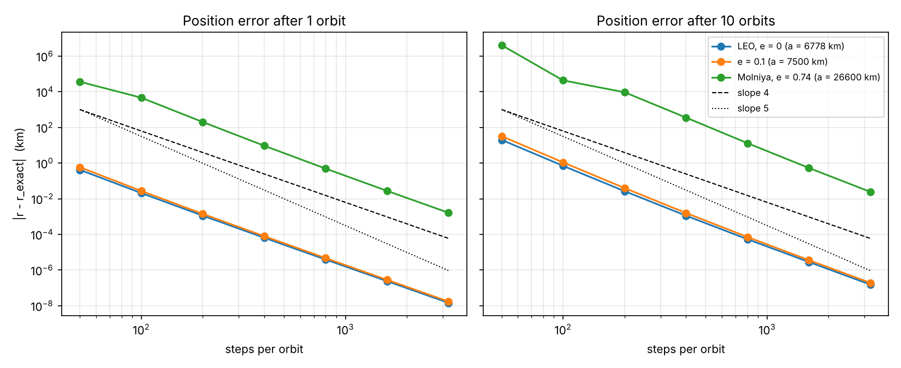
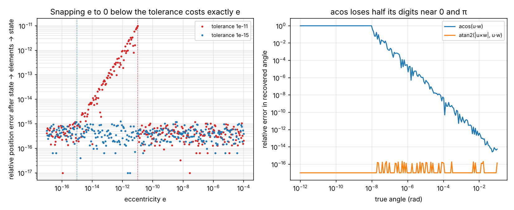
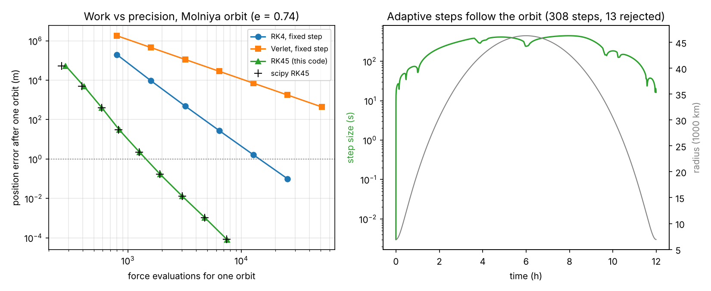
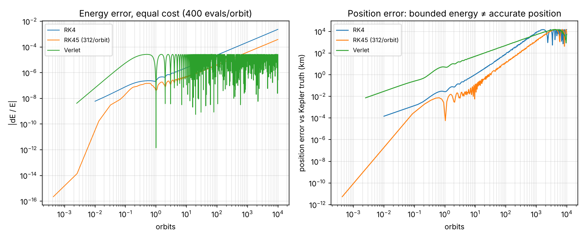
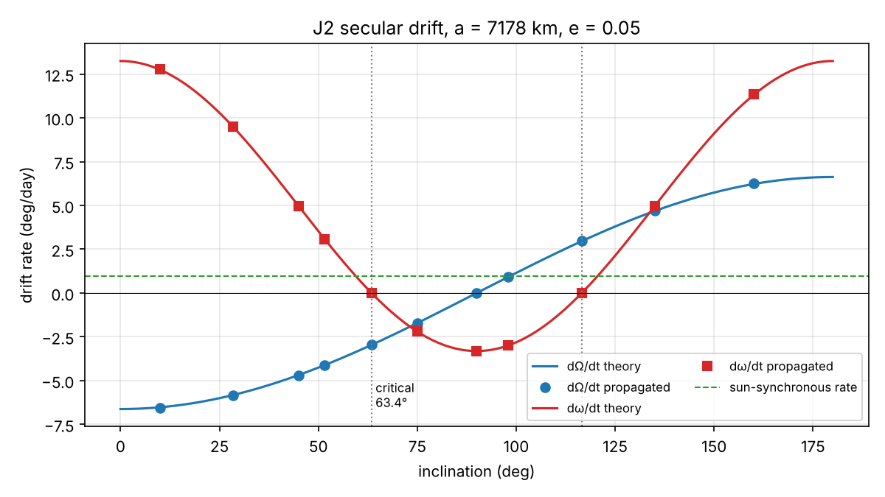
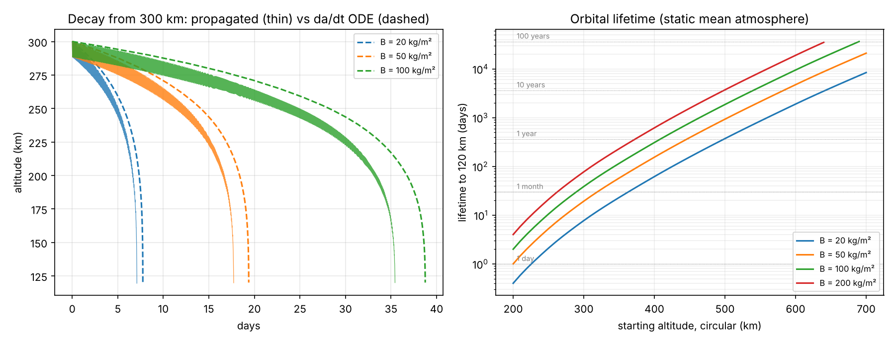
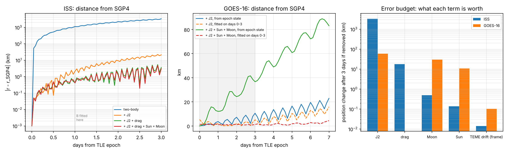

---
# Published from Obsidian by the Orbital Station publisher.
# Edit the note in your vault and publish again — changes made here are overwritten.
# source-id: 58d0b01a43e7
title: Building an Orbit Propagator from Scratch
date: 2026-11-25
summary: An Earth-orbit propagator built one force at a time, from a four-line integrator to the Sun, the Moon and the real ISS. Along the way, every error turned out to have a story.
orbit: systems
kind: build-log
tags: [orbits, numerical methods, satellites]
---

The oldest question in astrodynamics fits in one sentence: *if I know where a satellite is right now, where will it be tomorrow?*

For two point masses in empty space, Kepler answered it four hundred years ago, exactly. For a real satellite around the real Earth there is no exact answer. The planet bulges, the air drags, and the Sun and Moon pull from different directions every hour. You can only step forward in time, a few seconds at a slice, and hope the small errors in each step don't pile up into a large one.

I have a master's in aerospace engineering, and I spend my working days on calibration for photon-counting CT, a field whose whole culture is *show me the error bars*. Somewhere along the way I'd stopped writing physics code I could check line by line. So I set myself a project: build an orbit propagator from nothing, add one physical effect at a time, and never claim an accuracy I couldn't test. By the end there were 75 tests, and the most interesting parts of the project were the moments one of them failed.

## A clock that loses time

The first version knows only Newton: a satellite falling around a point-mass Earth, $\ddot{\mathbf r} = -\mu\,\mathbf r/r^3$. To march it forward I used the classical fourth-order Runge–Kutta method, RK4, the workhorse of every numerical methods course. It samples the slope four times per step and blends them so the errors cancel up to the fourth power of the step size. Halve the step, and the error should shrink sixteen-fold.

Over a single orbit it does exactly that. Over ten orbits, though, each halving shrank the error closer to *thirty-two*-fold, and that small discrepancy turned out to be the most useful thing I learned all project.

RK4 doesn't quite conserve energy. Every step leaks a tiny amount, always in the same direction. A satellite with slightly less energy sits in a slightly smaller orbit, and a smaller orbit is a *faster* one, so the simulated satellite gradually pulls **ahead** of the real one. The integrator behaves as if there were a faint atmosphere that doesn't exist. After 100 low orbits with a 28-second step, the fake orbit had sunk 3.6 metres and the satellite was 1.8 kilometres ahead of the truth.

I filed this away as a curiosity. It came back twice.

## Coordinates that lie

Position and velocity are an honest description of an orbit: six numbers, always well defined. Engineers prefer the six *orbital elements* instead (size, shape, tilt, and three angles), because they mean something to a human. The trouble is that some of those angles stop existing. A perfectly circular orbit has no closest point, so the angle that locates it is undefined. A perfectly equatorial orbit has no line where it crosses the equator, so that angle is undefined too.

Real satellites are almost never *exactly* circular or equatorial, but a lot of them are very nearly so. That's the worst case for the textbook formulas, which work beautifully right up until they divide by something close to zero.

The conversion code reproduced the textbook's worked examples on the first try, which proved nearly nothing. The real test was brute force: ten thousand random orbits, plus thousands more with eccentricity and inclination swept all the way down to $10^{-17}$. Convert each one to elements and back, and demand the original state to twelve digits. That test found three bugs the textbook examples had sailed straight past.

The first was a tolerance. To dodge the circular-orbit singularity, I'd told the code to treat any eccentricity below $10^{-11}$ as exactly zero. That sounds harmless, but rounding a number down to zero throws away exactly that much information, and every near-circular round trip came back wrong by up to $10^{-11}$. The second was a solver that could spin forever: Newton's method on Kepler's equation was told to stop when its step fell below $10^{-15}$, but near $2\pi$ the rounding noise in each step is about that size, so the step could bounce between two values for eternity. The third was Newton's method diverging outright for very elongated orbits.

The right-hand panel is the quiet hero of the whole project. The textbook recovers angles with an arccosine, and near zero an arccosine throws away half its digits. Below about $10^{-8}$ radians it simply returns zero. Computing the same angle with a two-argument arctangent keeps every digit. Near-singular orbits live exactly where the arccosine fails, so every angle in the code ended up using `atan2`.

## Spend your effort where the orbit is hard

A fixed time step is wasteful on an elongated orbit. A Molniya orbit, the kind Russia uses for communications at high latitudes, swings from about 500 kilometres up to nearly 40,000. Near the bottom it moves fast and needs tiny steps; near the top it barely moves. A fixed step has to be small enough for the hardest moment, everywhere.

The fix is an *adaptive* integrator, Dormand–Prince RK45, the method inside MATLAB's `ode45`. Each step computes two answers of different accuracy and uses the gap between them to decide how big the next step can be. Mine matches scipy's implementation to within a few percent at every tolerance I tried.

The fair way to compare integrators is to plot accuracy against *work*, the number of times you evaluate the forces. For one metre of accuracy after one Molniya orbit, the adaptive method needs about 1,300 force evaluations. Fixed-step RK4 needs about 13,000. The right-hand panel shows why: around 15-second steps through the fast bottom of the orbit, and up to 450-second steps on the slow part.

I also built the other famous option, velocity Verlet, a *symplectic* integrator. It's only second order, but it preserves the geometry of the motion exactly, so its energy error can never grow. Remember RK4's fake atmosphere? Verlet doesn't have one.

Over ten thousand orbits at equal cost, Verlet's energy error stays locked in the same narrow band while both Runge–Kutta methods drift steadily away. It looks like a clean win, until you check the right-hand panel. Verlet is the *worst* of the three at actually knowing where the satellite is: 510 kilometres off after 100 orbits, against 15 for the adaptive method. Its energy is right, but its clock runs slightly fast, so it slides around the orbit. Bounded energy is not the same thing as accuracy. Symplectic methods are the right tool for questions like "is the solar system stable over a billion years?" For tracking a satellite next Tuesday, they aren't.

## The bulge

Earth is not a sphere. Its equatorial radius is about 21 kilometres larger than its polar radius, and that extra ring of mass, the J2 term, is the single most important fact in near-Earth orbital mechanics. In low orbit it's only about 1/700 of gravity's total pull, yet it's a thousand times larger than any other perturbation. Leave it out and your prediction of the ISS is 460 kilometres off after one day.

The bulge tugs every inclined orbit toward the equator, and the orbit responds the way a spinning gyroscope does: its plane slowly swivels around Earth's axis. Engineers turn this nuisance into a tool. Tilt an orbit to just past polar, about 98° at 700 km, and the swivel rate becomes exactly one turn per year, matching Earth's trip around the Sun. The orbit plane then keeps the same angle to the Sun all year, which is why imaging satellites pass over every spot at the same local time. These are *sun-synchronous* orbits.

That was the milestone test. I propagated a sun-synchronous orbit for 30 days and measured how fast its plane turned: **0.98570° per day, against a target of 0.98561°**, a difference of nine thousandths of a percent.

Across eleven inclinations, the simulated drift matched the textbook formulas to within 0.3%. The chart also shows why Molniya orbits fly at 63.4°: at that *critical inclination* the low point of the orbit stops wandering, so the high, slow part stays parked over the northern hemisphere where it's useful.

There was one subtlety. The orbital elements computed from the simulation wobble by about twenty arcseconds, twice every orbit. The textbook formulas describe *averaged* elements, with the wobble smoothed out, so the only fair comparison is to fit a line through many orbits. "Instantaneous" versus "average" sounds like a footnote. It became the plot twist of the next two chapters.

## Falling faster by slowing down

Drag is the first force in the project that's *supposed* to drain energy. I built a layered model of the atmosphere, gave each satellite a ballistic coefficient (its mass divided by how much drag it presents), and let the air rotate with the planet. The full simulation, thousands of steps long, matched a simple one-line formula for orbital decay to within 0.2% all the way down to re-entry.

Then I wrote a test for something that sounds wrong: **drag makes satellites speed up.** It passed. Drag removes energy, the satellite sinks to a lower orbit, and lower orbits are faster, so gravity gives back more speed than the air took away. It's the reason you can't catch a spacecraft ahead of you by thrusting toward it.

With the full model switched on, though, satellites re-entered 8.5% sooner than the simple formula predicted. Close enough to shrug at. I took it apart instead. The rotating atmosphere *extends* lifetime by about 8%, because air moving with the satellite makes a weaker headwind. The bulge *shortens* it by about 15%. That was the averaging subtlety again: an orbit started at an instantaneous altitude of 300 kilometres actually oscillates between 288 and 300 under J2, averaging 293, where the air is about 15% thicker. Two effects in opposite directions, each traced to a cause, with a net that matched.

The right-hand panel became my rule of thumb for orbital lifetime. From 300 kilometres, weeks. From 400, months to a year, which is why the ISS needs regular reboosts. From 500, a few years. From 600 to 700, decades. All of it carries a large asterisk: the real upper atmosphere swells and shrinks about tenfold over the eleven-year solar cycle, and that uncertainty dwarfs everything else in the model.

And the fake atmosphere from the very beginning? I finally measured it against the real one. With a 30-second step, RK4's invented drag equals genuine drag at about 900 kilometres. A careless integrator would quietly invent half the decay of a high satellite, and nothing in the output would tell you.

## Meeting real satellites

Everything so far had been checked against theory. The last step was to check it against the sky.

I downloaded the current orbital elements for the International Space Station and for GOES-16, a weather satellite in geostationary orbit, from CelesTrak, and the positions of the Sun and Moon from JPL's Horizons system. Real data turned out to demand real bookkeeping. The orbital data uses UTC; the astronomy uses a time scale 69 seconds ahead. The standard model that accompanies satellite orbital data, SGP4, reports positions in an obscure coordinate frame called TEME, while JPL uses a frame fixed to distant quasars. Converting between them means accounting for Earth's axis slowly precessing, nodding on an 18.6-year cycle, and one more small rotation with a wonderfully Victorian name, the *equation of the equinoxes*.

I checked my frame conversion against astropy, the standard astronomy library, and it was fifteen arcseconds off. One sign was backwards on that last small rotation. After the fix, the two agree to 0.12 arcseconds, about fifteen metres at the altitude of the ISS. The Sun had a similar trap: my formula for its position only lined up with JPL's after accounting for the 26 years Earth's axis has precessed since the year 2000. Skip that, and the Sun lands 0.37° off, about two-thirds of its own apparent width.

Then the ISS. Starting from the same moment as the published orbital data and adding one force at a time, the gap between my propagator and SGP4 after one day fell from 1,120 kilometres (Earth as a perfect sphere) to 2.2 (with the bulge) to 0.43 (with drag) to **0.41 kilometres** with the Sun and Moon. After three days it was 3.0 kilometres. SGP4 itself is only good to a few kilometres, so that's about as close as the comparison can show. One honest caveat: I tuned the drag strength using the first day and treated the next two as a genuine prediction. The tuned value is higher than the station's physical one, because it also soaks up the difference between my textbook atmosphere and this week's real one. That's how operational orbit determination works too.

GOES-16 saved the best surprise for last. Adding the Moon and Sun made my prediction *worse*: 37 kilometres off after three days, against 11 kilometres with the bulge alone. For a moment it looked like a bug. It wasn't. SGP4 leaves out the Moon's short-period tug on geostationary orbits, so the starting position it hands you is subtly inconsistent with any model that has a real Moon in it. It's the averaged-versus-instantaneous problem a third time, now between two different models. The fair test is to fit the starting point to SGP4 over three days and then predict ahead. Done that way, the Sun and Moon cut the error at day seven from 16 kilometres to 4. Even in the unfitted run, the out-of-plane error tells the true story: 10 kilometres without the Sun and Moon, 1.5 with them. That steady tilting force is why geostationary satellites spend most of their fuel fighting it.

The last panel is an error budget: how far each satellite drifts in three days if you delete one force. For the ISS the bulge dominates everything (3,300 kilometres), then drag (18), then the Moon (0.5) and the Sun (0.14). At geostationary altitude the order flips: the Moon (30 kilometres) and the Sun (11) rival the bulge (59).

## What the errors taught me

Looking back, the project told one story with a few recurring characters.

The fake atmosphere from the first afternoon became the argument for adaptive steps, then a measuring stick for real drag. The gap between instantaneous and averaged orbits first appeared as a wobble on a chart, then explained why satellites fell faster than predicted, then explained why adding the Moon made things worse. None of those connections were planned. They showed up because every claim had to survive a test, and the failures were where the understanding was.

A few habits I'm keeping:

- **Brute-force testing beats worked examples.** The textbook cases passed every buggy version of the code. Ten thousand random orbits and an independent library found the real problems.
- **A tolerance is a physical claim.** Rounding something to zero is an approximation, and its error is the tolerance itself.
- **Rewrite formulas that subtract nearly equal numbers.** An arctangent instead of an arccosine, and a rearranged gravity formula for the Sun and Moon, each recovered digits that were silently being thrown away.
- **Comparing two models means aligning them fairly first.** Otherwise you measure the difference between their starting points, not their physics.

## Next mission

The obvious next question is the inverse one. This project asked where a satellite will be, given where it is. The next asks where a satellite *is*, given noisy measurements from the ground. That's orbit determination, done with least squares and Kalman filters, and this propagator becomes its engine.
